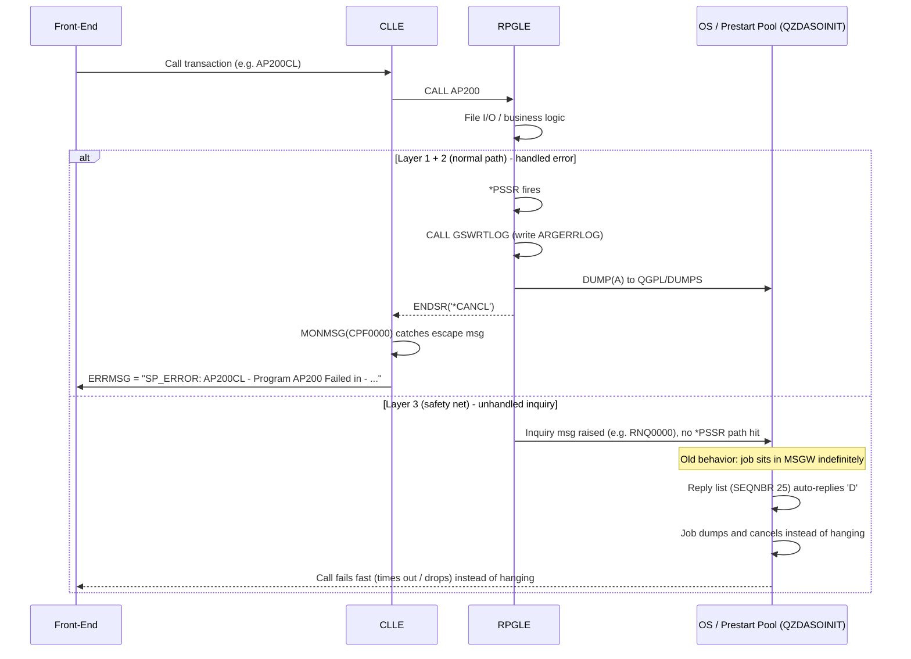

# ADR: Layered Error Handling for AS/400 RPGLE/CLLE Applications

**Status:** Draft v0.1 — for team review, expect to iterate
**Date:** 2026-08-06
**Owners:** ARG RPG team / Damco

## Context

RPGLE programs get called two ways: interactively, and from prestart jobs
(QZDASOINIT) servicing ODBC/JDBC calls from the front-end (e.g. EDI804/AP200
style calls). Prestart jobs have no interactive user attached. Historically,
when an RPGLE program hit an unhandled error, the job could end up sending an
inquiry message and sitting in **MSGW**, waiting forever for a reply that
would never come — the client call just hangs until someone notices and
cancels the job manually.

We're closing that gap, but not with a single fix — we're adding error
handling at three separate layers, each catching what the layer below it
might miss. This ADR is just meant to write down the shape of that stack
so everyone's pointing at the same mental model. Details (retention, naming,
etc.) can get refined later.

## Decision

Implement error handling at three layers:

### Diagram — normal path vs. each layer catching a failure



**Reading it:** the top branch (Layer 1 → Layer 2) is what we want almost
every failure to take — logged, dumped, and reported cleanly to the caller.
The bottom branch (Layer 3) only fires for whatever falls through both of
those; its job isn't to explain the failure, just to guarantee the
prestart job doesn't sit in MSGW forever.

### Layer 1 — RPGLE program level (the source of truth)

Every RPGLE program gets:
- `INFSR(*PSSR)` added to each F-spec, so file-related errors (dup key, etc.)
  route into the program's own error subroutine instead of defaulting.
- A `*PSSR` subroutine that:
  - Calls `GSWRTLOG`, passing the current program name, to write a row into
    a new error log file, **ARGERRLOG**.
  - `DUMP(A)` — produces a formatted program dump, landed in OUTQ
    `QGPL/DUMPS` (needs to exist on Power 10 too).
  - `ENDSR('*CANCL')` — cancels the program rather than retrying.

This is rolled out via a Damco-built tool (`EH0101`) that injects the
boilerplate into existing source (`CALL PGM(EH0101) PARM((lib)(file)(mbr))`),
so it doesn't have to be hand-added to every program.

**Example — F-spec:**

```rpgle
     Faptran    IP   F  404        DISK              INFSR(*PSSR)
     Fapcont    UF   F  256     2AIDISK    KEYLOC(2) INFSR(*PSSR)
```

**Example — `*PSSR` subroutine (added once per program):**

```rpgle
c* ==================================================================== *
c     *PSSR         BEGSR
c                    CALL      'GSWRTLOG'
c                    PARM      'AP200'       PgmName          10
c                    DUMP(A)
c                    ENDSR     '*CANCL'
c* ==================================================================== *
```

`PgmName` is just the current program's name, hardcoded per program so
`GSWRTLOG` knows who to attribute the log row to. `DUMP(A)` writes the
formatted dump; `ENDSR('*CANCL')` ends the program rather than trying to
resume — we want a clean failure, not a program limping on with bad state.

**This is the layer that actually knows what failed and why.**

### Layer 2 — CLLE orchestration level

Each CLLE that calls an RPGLE program wraps the call with
`MONMSG(CPF0000)`. On error, the CLLE populates an `ERRMSG` output parameter
in a fixed format:

```
SP_ERROR: <CL_Program> - Program <RPGLE_Program> Failed in - <Job>/<User>/<JobName> - <Date> - <Time>
```

The front-end surfaces that string directly to the caller/user instead of
the request just hanging.

**Example — CLLE wrapping an RPGLE call:**

```clle
             PGM        PARM(&ERRMSG)

             DCL        VAR(&ERRMSG)   TYPE(*CHAR) LEN(200)
             DCL        VAR(&JOBNBR)   TYPE(*CHAR) LEN(6)
             DCL        VAR(&JOBUSER)  TYPE(*CHAR) LEN(10)
             DCL        VAR(&JOBNAME)  TYPE(*CHAR) LEN(10)
             DCL        VAR(&SYSDATE)  TYPE(*CHAR) LEN(8)
             DCL        VAR(&SYSTIME)  TYPE(*CHAR) LEN(6)

             RTVJOBA    JOB(&JOBNAME) USER(&JOBUSER) NBR(&JOBNBR)
             RTVSYSVAL  SYSVAL(QDATE) RTNVAR(&SYSDATE)  /* or CVTDAT as needed */

             CALL       PGM(AP200)
             MONMSG     MSGID(CPF0000) EXEC(DO)
                CHGVAR     VAR(&ERRMSG) VALUE('SP_ERROR: AP200CL - Program' +
                             ' AP200 Failed in - ' *BCAT &JOBNBR *BCAT '/' +
                             *CAT &JOBUSER *BCAT '/' *CAT &JOBNAME)
                GOTO       CMDLBL(ENDPGM)
             ENDDO

             ENDPGM:
             ENDPGM
```

The exact date/time formatting is left flexible — the point for this ADR is
the shape: **call → `MONMSG(CPF0000)` → build `SP_ERROR:` string → return
it via `&ERRMSG`.** Every CLLE in the call chain should follow this same
pattern so the front-end always gets the same message shape regardless of
which program failed.

**This is the layer that turns a program failure into something the caller
can actually see.**

### Layer 3 — Subsystem / job level (the safety net)

Even with layers 1 and 2 in place, some conditions never reach the app's own
`*PSSR` (e.g. certain RPG runtime messages like `RNQ0000`) and can still
raise an inquiry message on a prestart job — which, again, has no one to
reply to it. This layer is the backstop:

- Add a reply-list entry: `ADDRPYLE SEQNBR(25) MSGID(RNQ0000) RPY('D') DUMP(*NO)`
  (an existing entry at seq 20 already does the same for `RPG0000`).
- Point the pool's job description at the reply list:
  `CHGJOBD JOBD(QGPL/QZDAJOBD) INQMSGRPY(*SYSRPYL)`.
- Recycle the QZDASOINIT prestart pool so running jobs pick it up.

Net effect: instead of hanging in MSGW, the job auto-replies **D** (dump)
and moves on — fast failure instead of a silent hang. `DUMP(*NO)` on this
entry is intentional: the app-level dump from Layer 1 is usually already
there, so we're not doubling up.

**This is the layer that catches anything that slips past the first two.**

## Why three layers instead of one

- Layer 1 gives us the most useful diagnostic (log entry + dump), but only
  if the program was updated with the `EH0101` changes.
- Layer 2 gives the caller a clean, visible failure message, but only
  covers CLLE-to-RPGLE call paths.
- Layer 3 doesn't know anything about *why* something failed — it just
  guarantees nothing hangs indefinitely, even for programs/paths we haven't
  instrumented yet or didn't anticipate.

Together: known failures are logged and reported cleanly; unknown/unhandled
ones still fail fast instead of hanging a prestart job.

## Consequences

- The Layer 3 change is **box-wide** (`QZDAJOBD` is shared) — PROD prestart
  jobs get dump-and-cancel behavior too, not just the target app. Worth
  calling out explicitly in the change record.
- `QGPL/QZDAJOBD` is IBM-supplied, so an OS upgrade or `RSTLIB QGPL` can
  silently revert the `INQMSGRPY` setting — add to the post-upgrade
  checklist.
- If some CL in the codebase issues a runtime `CHGJOB INQMSGRPY(*DFT)`,
  it'll override the reply list for that job and reply `C` (cancel, no
  dump) instead — worth grepping for.
- There's a brief window during the prestart-pool recycle where new DB
  connections are refused; needs to be timed around batch/ETL windows.

## Open questions / next iteration

- Retention/rotation policy for `QGPL/DUMPS` and `ARGERRLOG`.
- Whether Layer 3's reply-list approach should eventually cover other
  message IDs beyond `RNQ0000`/`RPG0000`.
- Whether we want a periodic job to clear stale `RNQ1216` backlog in
  QSYSOPR automatically rather than doing it manually.
- Real date/time capture in the CL snippet (`RTVSYSVAL`/`CVTDAT` details)
  is illustrative above — confirm the exact fields Damco's existing CLLE
  template already uses so we don't reinvent it.
