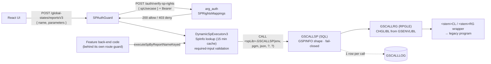

# AS400 Stored Procedure Calls

**Title:** Calling Legacy RPG/CL Programs from Node.js through the GSCALLSP Generic Stored Procedure (v3)
**Date:** 2026-10-11
**Status:** Proposed
**Owners:** ARG (Michael, Jeremy, RPG team) / Damco (Kuldeep, Anand, Vineet)

## Context

The modernized front end must run hundreds of legacy AS400 programs (AP, AR, order entry, billing, freight, …) without the Node back end writing new code for each one. Earlier executors (v1/v2) called SPs dynamically by name, but each program needed a hand-verified positional signature, every output field cost its own DB2 global variable, and every outcome came back as a success status. See the [appendix](#appendix-legacy-v1v2-executors-informational) for those versions.

**This ADR is the rule for all new and changed SP work.** Every call from Node to a legacy program uses the v3 executor and GSCALLSP as described here.

Sources:
- *ARG Generic SP — User Manual (v2.2)*
- *GSCALLSP v3 Knowledge Transfer*
- *Securing Stored Procedures with Rights-Based Authorization*
- the standups summarized in [`_discussion/AS400 Error Handling and SP Calls - Decision Brief.md`](_discussion/AS400%20Error%20Handling%20and%20SP%20Calls%20-%20Decision%20Brief.md)
- `arg-web-backend` (commit `9381c9cb2`, 2026-10-11)

## Decision

Every call from Node to a legacy program:
- goes through the **v3 executor**,
- is protected by **per-use-case rights**,
- is executed by **one fixed-shape stored procedure (GSCALLSP)**, and
- is answered with **one standard response and HTTP status mapping**.

### 1. One endpoint, one executor

- **Front-end calls** use **`POST /global-states/reportsV3 { name, parameters }`**.
  - `name` is the SP use-case key. It is resolved through `SpInfo`, Node's mirror of the AS400 `GSPINFO` registry.
  - New screens must not use `/reports` or `/reportsV2` (see the appendix).
- **Feature back-end code** may call the v3 executor directly (`SpExecutionInterfacev3.executeSpByReportNameKeyed`), for example billing BOL entry and the invoice-batch repositories.
  - These calls follow the same response and error rules as the endpoint.
  - They are **not** covered by `SPAuthGuard` (section 2). The feature's own route guard must authorize them.
- **Onboarding a program** means registering its `GSPINFO` rows and mapping its rights. In the normal case, no Node code is needed.
  - `GSPINFO` changes can take up to 15 minutes to take effect, because each app instance caches `SpInfo`.
  - **Known exception:** `BB510PCL` (Invoice Print) has a Node preflight check. It returns 422 when Invoice Edit has not run, because the wrapper skips BB510P's own check.
- **The SP library and the environment ID are always set by the server, never by the request.**
  - The library (`spLib`) comes from `ENV_LIBRARY_CONFIG`, set per environment by server config.
  - GSCALLSP's `in_env` argument is the server's `NODE_ENV`.
  - Any `env` / `environment` / `envid` program parameter must also be set by the server (see Open items).

### 2. Authorization layer

- **`SPAuthGuard`** in `arg-web-backend` reads `body.name` and the access token (the `access-token` cookie or a Bearer header). It calls **`arg_auth POST /auth/verify-sp-rights { spUsecase }`**, with a 15-second timeout. Node does not make the rights decision itself.
- `arg_auth` resolves the user's effective rights (User → Groups → GroupRights → Rights). It allows the call if the user holds a right mapped to the use-case in **`SPRightsMappings`**.
- Rights take the form **`MODULE::Feature::RW`**. Only `::RW` rights authorize SP execution. A use-case can map to several rights.
- **Fail-closed.** The guard returns **403** and the SP never runs when:
  - the name or token is missing,
  - the use-case has no mapping (or a NULL right),
  - the user lacks the right, or
  - arg_auth times out.
- Mappings are maintained per module in the Admin Panel (*Config → SP & Report → SP Rights Mappings*). Changes take effect on the next call, with no deploy. New use-cases are synced from SPINFO, and use-cases missing from the source are flagged.

### 3. The call (GSCALLSP v3)

- Every program is called with one fixed signature: `CALL <spLib>.GSCALLSP(in_env, in_program, in_request_json, OUT out_result_json, OUT out_return_msg [, in_trace])`.
- **Request:** `{"parms":[{"name":"<MEFLDKEY>","value":"<string>"}, …]}`.
  - Names are case-sensitive.
  - Every value is a string.
  - DS subfields are sent flat.
  - Dates are always `MMDDYY`.
  - Node checks that every required `in` field was supplied. It logs and drops fields that aren't registered.
- **Fail-closed before dispatch:** an unregistered program (75001), an unknown parameter (75002), or a duplicate parameter (75003) never reaches the target program.
- Targets are always generated wrappers (`<stem>CL` / `<stem>RG`), never raw legacy programs. The wrapper standards (`DFTACTGRP(*YES)`, a clean exit, and `*JOB` overrides deleted on every path) are in the User Manual, section 4.1.
- Every call writes one **`GSCALLLOG`** audit row, whether it succeeds or fails. The row holds the input and output JSON, the status, the job, and the elapsed time.

### 4. Standard response

There are two status channels, and Node reads both:

| Channel | Values | Meaning |
|---|---|---|
| `out_return_msg` (transport) | `SUCCESS <pgm>: completed` / `ERROR <pgm>: <detail>` | Whether the call was dispatched and returned without an escape message. Anything not starting with `SUCCESS` is a failed call. |
| `ERRMSG` (or `P_ERRMSG`) in the result JSON (program verdict) | `SP_SUCCESS:` / `SP_WARN:` / `SP_ERROR:` / `SP_FATAL:` | The program's own verdict (tags below) |

**SP tags** (ARG / Damco agreed):

| `ERRMSG` prefix | Agreed meaning | Result |
|---|---|---|
| `SP_SUCCESS:` | No business or technical error | Output returned · **200** |
| `SP_WARN:` | Agreed warning; the work completed | Output returned, warning logged · **428** *(see Open items)* |
| `SP_ERROR:` | Business error (catch-all), as the wrapped program reports it | **422** |
| `SP_FATAL:` | Technical error; the process cannot continue | **500** |

- **Every wrapper must return one of the four prefixes.** `SP_FATAL:` replaces the old practice of reporting a program failure (for example, a `*PSSR` dump) as `SP_ERROR:`.
  - Node currently treats a blank or unprefixed `ERRMSG` as success (`BLANK_ERRMSG_IS_SUCCESS`). This is a temporary tolerance for wrappers that don't follow the contract yet, not part of the contract.
- **On success,** the result includes every registered parameter (inputs are echoed back), with DS groups nested. Values are strings and must be read by key, not by position.
- **On failure,** GSCALLSP's result JSON contains only `_JOB` / `_TS`. It never contains partial data or data from a previous call.
- **`_JOB` / `_TS` are always present.** They give the exact QZDASOINIT job and the call's start time. They are the key into the job log, `GSCALLLOG`, and Grafana. Do not put job details in `ERRMSG`; that old suffix is deprecated.
- **`/reportsV3` response shape:** `{ items: { ...spFields, message }, metadata: { _JOB, _TS } }`. On a 422, `_JOB` is also returned in the error detail's `id`.
- **Direct callers** use `executeSpByReportNameKeyed`, which returns the keyed fields including `_JOB` / `_TS`, and check the result with `assertSpResult`.

### 5. HTTP status codes

**An SP error must never return a success status** (decided 2026-09-16). The back end decides the status from the two channels above, in `assertSpResult` and `executeV3`. The front end does not string-match messages. Only technical failures open the error modal; business outcomes are shown on the screen.

**Node response table:**

| Status | Kind | Error modal | Typical screen behavior |
|---|---|---|---|
| 200 / 201 | Success | No | Normal flow |
| 400 | Validation | No | Highlight the field in `details[].field` |
| 401 | Session expired | No (session warning instead) | Log out and reload |
| 403 | Not authorized | No | No Access page |
| 404 / 409 | Legacy business codes (being migrated to 422) | No | Toast or inline message |
| 422 | Business refusal | No | Toast or inline message with the program's own text |
| 428 | Warning | No | Warning |
| 429 | Rate limited | No | Retry later |
| 500 / 503 | Technical failure | **Yes** | Modal with the reason and tracing IDs (`_JOB`, `_TS`, correlation ID) |
| No response | Network / timeout | **Yes** (unless aborted) | Modal saying no response came back |

**How an SP call maps onto it:**

| SP outcome | HTTP | Error code |
|---|---|---|
| `SUCCESS` + `SP_SUCCESS:` | 200 | — |
| `SUCCESS` + `SP_WARN:` | 428 *(code returns 200 today; see Open items)* | — |
| Name/token missing, no mapping, right not held, auth timeout | 403 | `FORBIDDEN` |
| Required input missing (Node check, before the call) | 400 | `SP_MISSING_PARAMS` |
| `SUCCESS` + `SP_ERROR:` | 422 | `SP_ERROR` |
| `SUCCESS` + `SP_FATAL:` | 500 | `SP_FATAL` |
| `ERROR` in `out_return_msg` (program failed) | 500 | `SP_PROGRAM_FAILED` |
| Program not registered in GSPINFO | 500 | `SP_NOT_REGISTERED` |
| ODBC/connection failure, config error, other thrown error | 500 | `SP_EXECUTION_FAILED` |

**Target, not yet built:** `SP_ERROR:` returns **400** with `details[].field` when the wrapper identifies the field at fault.

## Reasoning

- **One executor plus data-driven rights.** This keeps the "no back-end code per program" delivery model. It also closes the gap where any authenticated user could run any SP, because rights are checked per use-case instead of per route.
- **Fixed-shape call.** The AS400 side becomes the single source of truth for parameter shape. Output always uses 2 variables, however many fields the program returns. Measured times: BB506HRG dropped from 44.9 ms to 15.6 ms (median), and BB1011RG runs in 9.1 ms. Schema drift fails closed with a readable error, not garbage data.
- **Two channels, four tags, one status table.** "The call broke" and "the program failed" (500, modal) are kept separate from "the program said no" (422, inline) and "done, with a warning". The UI chooses its behavior from the HTTP status alone.
- **`_JOB`/`_TS` on every result.** Prestart jobs are reused and never end, so the job that served a call can't be determined afterwards. These keys make every failure traceable from the screen.

**Alternatives considered:**
- **One endpoint per module or purpose, backed by a shared utility.** This direction was agreed on 2026-08-20. Per-use-case rights now meet the security need, so the split is **deferred to phase 2**. At that point, as SPs are rewritten, semantic endpoints would keep the front end pointed at the same URLs.
- **Continue on v1/v2.** Rejected because of the per-program signature upkeep, the per-field variable cost, and the success-on-error behavior.

## Consequences

**Positive**
- To onboard a program, register it in `GSPINFO` and map its rights. Normally no Node change or deploy is needed.
- Authorization for front-end calls is centralized, fail-closed, module-scoped, and maintained by admins.
- Every call is audited (`GSCALLLOG` plus Node stage logging) and can be traced to a job from the UI.
- Errors produce error statuses, classified on the back end.

**Negative / risks**
- Direct executor calls from feature code bypass the per-use-case rights check and rely on their route's guard.
- Each wrapper must emit the correct tag. Wrappers that still report program failures as `SP_ERROR:` will show them as business refusals with no modal.
- An arg_auth outage or timeout appears to the user as a 403 (No Access page), not as a technical failure.
- Logging and metrics on the shared route need the use-case name from the payload to tell processes apart.
- `SPRightsMappings` must be kept in sync with SPINFO. An unmapped new use-case is denied until an admin maps it.

## Open items

- **Server-set environment parameter (code fix).** `buildRequestParmsForSp` (`dynamic-sp-executor-v3.ts:659`) passes a client-supplied non-blank `env` / `environment` / `envid` value through to the program. The server must always set it.
- **`SP_WARN` status.** The code returns 200 and keeps the `SP_WARN:` text in `items.message`, and the front end matches on that text. The code also already uses 428 to mean "nothing saved; confirm and resubmit with an override" (`confirmationRequired`). Decide between:
  - keeping `SP_WARN` → 428, which means changing the code and choosing another way to signal confirm-required, or
  - `SP_WARN` → 200 with the warning in the body.
- **Library defaults.** The `ENV_LIBRARY_CONFIG` defaults for test and UAT are `GSSLIBTEST` / `GSSLIBUAT`. The User Manual says `ARGLIB<env>` and that GSS libraries are never on the library list. Reconcile the two, and set a prod value.
- **Blank `ERRMSG` tolerance.** Inventory the non-conforming wrappers, then set `BLANK_ERRMSG_IS_SUCCESS` to false.
- **`SP_FATAL:` rollout.** Add it to the GSCALLSP User Manual (sections 3.3 / 5.1) and to the wrapper generator, and re-tag the wrappers that need it.
- **Field-level 400.** Define how a wrapper tells Node which field caused an `SP_ERROR:`.
- **Rights for direct calls.** Decide whether direct executor callers must also check use-case rights.
- **Auth timeout.** Should an arg_auth timeout return 503 (modal) instead of 403?
- **Legacy migration.** Move `/reports` and `/reportsV2` callers (including AR/AP) onto v3, then retire v1/v2 (Decision Brief D4, D13). Plan the move from wrapped calls to native `*PR` procedures (D13).

---

## Appendix: Legacy v1/v2 executors (informational)

*This appendix describes what is still running. It is not part of the rule above; do not use these paths for new work.*

| Route | Executor | Notes |
|---|---|---|
| `POST /global-states/reports` | v1 (`dynamic-sp-executor.ts`), or v2 when `SP_VERSION=v2` | Used by AR and AP |
| `POST /global-states/reportsV2` | v2 | |

- **How they call:** a positional `CALL SCHEMA.SPNAME(:p1, …, outVar1, …)` built from `SpInfo`, with one dynamically created and dropped DB2 global variable per output field, per call.
- **How they report errors:** they return **201 for every outcome**. The front end string-matches `SP_ERROR` in the message to colour its toast, so an SP failure never produces an error status or the modal. For example, OR 494 showed no user-facing error.
- **Testing:** test error surfacing on group 2 (v3) screens, not on AR/AP.
- **Compatibility:** v3 is additive. `executeSpByReportName` on v3 returns the same positional output as v1, so callers can move over without reshaping results.
