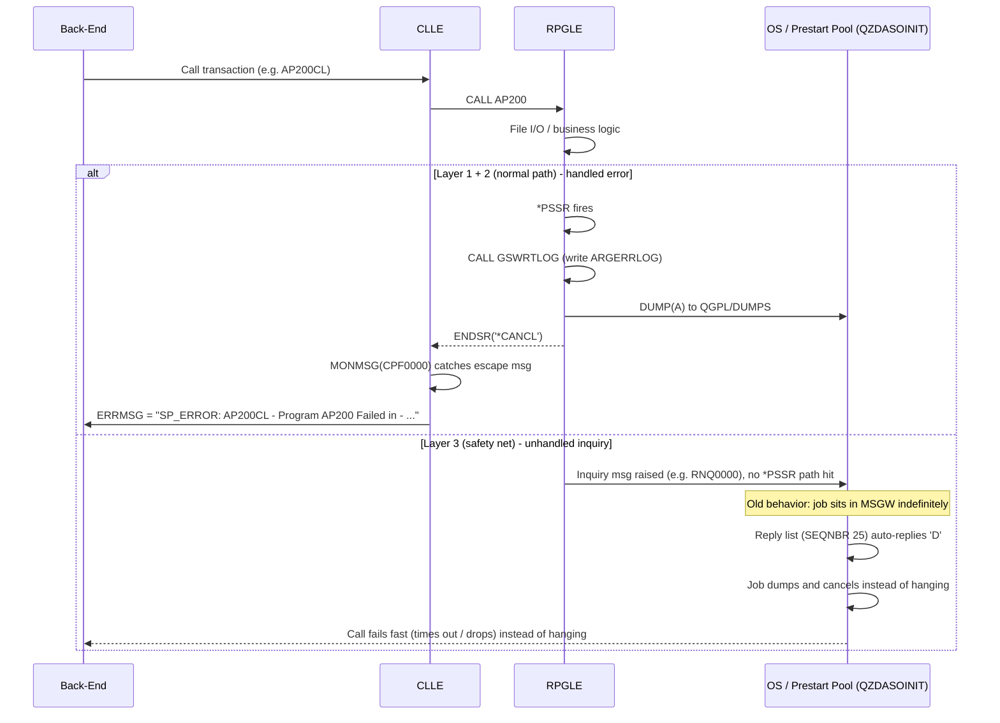

# RPG Error Handling Standards

**Title:** Layered Error Handling Standards for AS/400 RPGLE/CLLE Applications
**Date:** 2026-08-06
**Status:** Proposed
**Owners:** ARG RPG team / Damco

## Context

**Architectural Problem:** RPGLE programs are invoked two ways — interactively, and from prestart jobs (QZDASOINIT) servicing ODBC/JDBC calls from the front-end (e.g. EDI804/AP200 style calls). Prestart jobs have no interactive user attached. Historically, when an RPGLE program hit an unhandled error, the job could send an inquiry message and sit in **MSGW**, waiting indefinitely for a reply that would never come. The client call hangs until someone notices and cancels the job manually.

**Key Factors and Constraints:**
- Prestart jobs (QZDASOINIT) have no attached user to answer inquiry messages
- A hung prestart job silently consumes a connection from the pool and blocks the calling front-end request
- Some conditions (certain RPG runtime messages such as `RNQ0000`) never reach an application's own `*PSSR`, so program-level handling alone cannot close the gap
- Not every existing RPGLE program can realistically be hand-instrumented — boilerplate must be injectable
- The prestart job description (`QGPL/QZDAJOBD`) is IBM-supplied and shared box-wide, so job-level changes have blast radius beyond the target application
- Failures need to be both diagnosable (for developers) and visible (to the caller/user)

**Options Considered:**
- **Program-level handling only** (`*PSSR` in every RPGLE program) — rejected as sole approach: does not cover programs not yet instrumented, and misses conditions that bypass `*PSSR` entirely
- **CLLE-level monitoring only** (`MONMSG`) — rejected as sole approach: only covers CLLE-to-RPGLE call paths and produces no diagnostic detail
- **Subsystem reply-list only** (`ADDRPYLE` / `INQMSGRPY`) — rejected as sole approach: guarantees fast failure but knows nothing about *why* something failed
- **Layered approach combining all three** — selected, each layer catching what the layer below it might miss

**System Context:** IBM i (AS/400) environment. RPGLE programs called from CLLE orchestration programs, reached from the front-end through ODBC/JDBC against the QZDASOINIT prestart job pool. Error logging targets a new file, **ARGERRLOG**; formatted dumps target OUTQ `QGPL/DUMPS`.

## Decision

**Architectural Decision:** Implement error handling at three independent layers — RPGLE program level, CLLE orchestration level, and subsystem/job level — so that known failures are logged and reported cleanly, and unknown or unhandled failures still fail fast rather than hanging a prestart job.

### Normal path vs. each layer catching a failure



**Reading it:** the top branch (Layer 1 → Layer 2) is the path almost every failure should take — logged, dumped, and reported cleanly to the caller. The bottom branch (Layer 3) only fires for whatever falls through both of those; its job is not to explain the failure, only to guarantee the prestart job does not sit in MSGW forever.

### Layer 1 — RPGLE program level (the source of truth)

Every RPGLE program gets:
- `INFSR(*PSSR)` added to each F-spec, so file-related errors (duplicate key, etc.) route into the program's own error subroutine instead of defaulting.
- A `*PSSR` subroutine that:
  - Calls `GSWRTLOG`, passing the current program name, to write a row into the new error log file **ARGERRLOG**.
  - `DUMP(A)` — produces a formatted program dump, landed in OUTQ `QGPL/DUMPS` (must exist on Power 10 as well).
  - `ENDSR('*CANCL')` — cancels the program rather than retrying.

This is rolled out via a Damco-built tool (`EH0101`) that injects the boilerplate into existing source (`CALL PGM(EH0101) PARM((lib)(file)(mbr))`), so it does not have to be hand-added to every program.

**This is the layer that actually knows what failed and why.**

### Layer 2 — CLLE orchestration level

Each CLLE that calls an RPGLE program wraps the call with `MONMSG(CPF0000)`. On error, the CLLE populates an `ERRMSG` output parameter in a fixed format:

```
SP_ERROR: <CL_Program> - Program <RPGLE_Program> Failed in - <Job>/<User>/<JobName> - <Date> - <Time>
```

The front-end surfaces that string directly to the caller/user instead of the request hanging. Every CLLE in the call chain follows this same pattern so the front-end always gets the same message shape regardless of which program failed.

**This is the layer that turns a program failure into something the caller can actually see.**

### Layer 3 — Subsystem / job level (the safety net)

Even with layers 1 and 2 in place, some conditions never reach the application's own `*PSSR` (e.g. certain RPG runtime messages like `RNQ0000`) and can still raise an inquiry message on a prestart job — which, again, has no one to reply to it. This layer is the backstop:

- Add a reply-list entry: `ADDRPYLE SEQNBR(25) MSGID(RNQ0000) RPY('D') DUMP(*NO)` (an existing entry at seq 20 already does the same for `RPG0000`).
- Point the pool's job description at the reply list: `CHGJOBD JOBD(QGPL/QZDAJOBD) INQMSGRPY(*SYSRPYL)`.
- Recycle the QZDASOINIT prestart pool so running jobs pick it up.

Net effect: instead of hanging in MSGW, the job auto-replies **D** (dump) and moves on — fast failure instead of a silent hang. `DUMP(*NO)` on this entry is intentional: the application-level dump from Layer 1 is usually already present, so dumps are not doubled up.

**This is the layer that catches anything that slips past the first two.**

## Reasoning

**Defense in Depth — Why Three Layers Instead of One**
- Layer 1 gives the most useful diagnostic (log entry + dump), but only if the program was updated with the `EH0101` changes.
- Layer 2 gives the caller a clean, visible failure message, but only covers CLLE-to-RPGLE call paths.
- Layer 3 knows nothing about *why* something failed — it only guarantees nothing hangs indefinitely, even for programs and paths not yet instrumented or not anticipated.
- Together: known failures are logged and reported cleanly; unknown/unhandled failures still fail fast instead of hanging a prestart job.

**Diagnosability**
- `ARGERRLOG` gives a queryable record of failures attributed to a specific program.
- `DUMP(A)` to `QGPL/DUMPS` preserves full program state at the point of failure for post-mortem analysis.
- Layer 1 captures the failure at the only point in the stack that still has business context.

**Caller Visibility and Fail-Fast Behavior**
- The fixed `SP_ERROR:` string shape means the front-end can surface a consistent message without knowing which program failed.
- `ENDSR('*CANCL')` produces a clean failure rather than a program limping on with bad state.
- Auto-reply `D` converts an indefinite MSGW hang into a bounded, observable failure (timeout/drop) that the front-end can react to.

**Maintainability and Rollout**
- The `EH0101` injection tool avoids hand-editing every RPGLE source member, making Layer 1 coverage feasible at scale.
- A single fixed `ERRMSG` format across all CLLE programs keeps front-end error handling uniform.
- Layer 3 requires no application changes at all, so it protects legacy paths that will never be instrumented.

**Trade-offs Considered:**
- Box-wide job description change vs. targeted application-only handling — accepted for coverage of uninstrumented paths
- Dump storage growth vs. diagnostic completeness
- Brief connection-refusal window during pool recycle vs. immediate rollout of the safety net

**Risks Mitigated or Accepted:**
- **Mitigated:** indefinite prestart job hangs, silent connection-pool exhaustion, undiagnosable failures
- **Accepted:** IBM-supplied `QZDAJOBD` can be reverted by an OS upgrade or `RSTLIB QGPL`; box-wide behavior change affects PROD prestart jobs beyond the target application

## Consequences

### Positive
- **No Indefinite Hangs:** Prestart jobs fail fast instead of sitting in MSGW awaiting a reply that will never come.
- **Queryable Error History:** `ARGERRLOG` provides a persistent, program-attributed record of failures.
- **Full Post-Mortem State:** `DUMP(A)` output in `QGPL/DUMPS` preserves program state at failure.
- **Consistent Caller Experience:** The fixed `SP_ERROR:` format gives the front-end a uniform message shape from any failing program.
- **Coverage Beyond Instrumented Code:** Layer 3 protects programs and paths that have not been (and may never be) updated with `EH0101`.
- **Scalable Rollout:** The `EH0101` tool injects Layer 1 boilerplate without hand-editing each source member.
- **Clean Failure Semantics:** `ENDSR('*CANCL')` prevents programs continuing with corrupt state.

### Negative
- **Box-Wide Blast Radius:** The Layer 3 change affects the shared `QGPL/QZDAJOBD`, so PROD prestart jobs get dump-and-cancel behavior too, not just the target application. This must be called out explicitly in the change record.
- **Revertible by OS Maintenance:** `QGPL/QZDAJOBD` is IBM-supplied, so an OS upgrade or `RSTLIB QGPL` can silently revert the `INQMSGRPY` setting. Must be added to the post-upgrade checklist.
- **Runtime Override Risk:** Any CL in the codebase issuing `CHGJOB INQMSGRPY(*DFT)` overrides the reply list for that job and replies `C` (cancel, no dump) instead. The codebase should be grepped for this.
- **Recycle Outage Window:** There is a brief window during the prestart-pool recycle where new DB connections are refused; this needs to be timed around batch/ETL windows.
- **Unbounded Dump Growth:** No retention or rotation policy yet exists for `QGPL/DUMPS` or `ARGERRLOG`.
- **Per-Program Hardcoding:** `PgmName` is hardcoded per program in the `*PSSR`, so a program rename requires the boilerplate to be updated.

## Implementation Notes

**Layer 1 — F-spec with `INFSR(*PSSR)`:**

```rpgle
     Faptran    IP   F  404        DISK              INFSR(*PSSR)
     Fapcont    UF   F  256     2AIDISK    KEYLOC(2) INFSR(*PSSR)
```

**Layer 1 — `*PSSR` subroutine (added once per program):**

```rpgle
c* ==================================================================== *
c     *PSSR         BEGSR
c                    CALL      'GSWRTLOG'
c                    PARM      'AP200'       PgmName          10
c                    DUMP(A)
c                    ENDSR     '*CANCL'
c* ==================================================================== *
```

`PgmName` is the current program's name, hardcoded per program so `GSWRTLOG` knows who to attribute the log row to. `DUMP(A)` writes the formatted dump; `ENDSR('*CANCL')` ends the program rather than trying to resume.

**Layer 1 — Boilerplate injection:**

```
CALL PGM(EH0101) PARM((lib)(file)(mbr))
```

**Layer 2 — CLLE wrapping an RPGLE call:**

```clle
             PGM        PARM(&ERRMSG)

             DCL        VAR(&ERRMSG)   TYPE(*CHAR) LEN(200)
             DCL        VAR(&JOBNBR)   TYPE(*CHAR) LEN(6)
             DCL        VAR(&JOBUSER)  TYPE(*CHAR) LEN(10)
             DCL        VAR(&JOBNAME)  TYPE(*CHAR) LEN(10)
             DCL        VAR(&SYSDATE)  TYPE(*CHAR) LEN(8)
             DCL        VAR(&SYSTIME)  TYPE(*CHAR) LEN(6)

             RTVJOBA    JOB(&JOBNAME) USER(&JOBUSER) NBR(&JOBNBR)
             RTVSYSVAL  SYSVAL(QDATE) RTNVAR(&SYSDATE)  /* or CVTDAT as needed */

             CALL       PGM(AP200)
             MONMSG     MSGID(CPF0000) EXEC(DO)
                CHGVAR     VAR(&ERRMSG) VALUE('SP_ERROR: AP200CL - Program' +
                             ' AP200 Failed in - ' *BCAT &JOBNBR *BCAT '/' +
                             *CAT &JOBUSER *BCAT '/' *CAT &JOBNAME)
                GOTO       CMDLBL(ENDPGM)
             ENDDO

             ENDPGM:
             ENDPGM
```

The exact date/time formatting is left flexible — the required shape is: **call → `MONMSG(CPF0000)` → build `SP_ERROR:` string → return it via `&ERRMSG`.**

**Layer 3 — Configuration commands:**

```
ADDRPYLE   SEQNBR(25) MSGID(RNQ0000) RPY('D') DUMP(*NO)
CHGJOBD    JOBD(QGPL/QZDAJOBD) INQMSGRPY(*SYSRPYL)
```

Then recycle the QZDASOINIT prestart pool so running jobs pick up the change.

**Reply-list entries:**

| SEQNBR | MSGID | Reply | Dump | Notes |
|--------|-------|-------|------|-------|
| 20 | `RPG0000` | `D` | — | Pre-existing entry |
| 25 | `RNQ0000` | `D` | `*NO` | Added by this decision; app-level dump from Layer 1 already covers the diagnostic |

**Migration and Deployment Considerations:**
- `QGPL/DUMPS` OUTQ must exist on Power 10 as well as lower environments.
- `ARGERRLOG` must be created before Layer 1 rollout, since `GSWRTLOG` writes to it.
- Time the prestart-pool recycle around batch/ETL windows to avoid connection refusals during active load.
- Add the `QGPL/QZDAJOBD` `INQMSGRPY(*SYSRPYL)` setting to the post-OS-upgrade verification checklist.
- Grep the codebase for `CHGJOB INQMSGRPY(*DFT)` before relying on Layer 3.

## Related Decisions

- [RPG Program and Database File Development Standards](RPG%20Development%20Standards.md) — establishes the library structure and Power 8 / Power 10 environment split this decision deploys into.

## References

*[To be added as external documentation and standards are referenced]*

---

**Open Questions / Next Iteration:**
- Retention and rotation policy for `QGPL/DUMPS` and `ARGERRLOG`.
- Whether Layer 3's reply-list approach should eventually cover message IDs beyond `RNQ0000` / `RPG0000`.
- Whether a periodic job should clear stale `RNQ1216` backlog in QSYSOPR automatically rather than doing it manually.
- Real date/time capture in the CL snippet (`RTVSYSVAL` / `CVTDAT` details) is illustrative above — confirm the exact fields Damco's existing CLLE template already uses so it is not reinvented.
